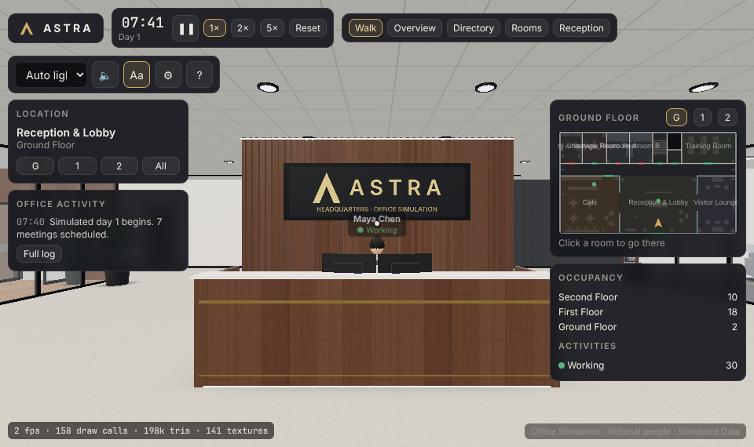

# ASTRA Headquarters — Office Simulation

An interactive, frontend-only 3D office simulation of a fictional investment firm's three-floor
headquarters. Walk the building, visit every room, approach any of the 30 employees, inspect their desks
and monitors, and watch a seeded office day unfold: trading, research, meetings, café breaks, a simulated
risk-limit breach and a technology incident.

**Everything is simulated.** People are fictional, editable placeholders; every price, position, P&L and
metric is labelled *Simulated Data* and produced by a local seeded model. There is no backend, no
authentication, no paid API, no real trading and no monitoring of real people.



## Quick start

Requirements: Node.js 20+ (tested with Node 22.22.0, npm 10.9.4) and a browser with WebGL 2.

```bash
cd astra-hq
npm install          # install dependencies
npm run dev          # development server at http://localhost:5173
npm run build        # type-check + production build into dist/
npm run preview      # serve the production build at http://localhost:4173
npm test             # unit tests (vitest): layout, navigation, simulation, configuration
npm run e2e          # browser acceptance checks against dist/ (needs a Chromium; see below)
```

`dist/` is a static site (relative paths) and can be hosted from any static file server or sub-folder.

The browser checks use `playwright-core` with the Chromium at `/opt/pw-browsers/chromium-1194/chrome-linux/chrome`;
set `CHROMIUM_PATH` to use another Chromium build. They run on SwiftShader (software GL), so they verify
behaviour, not frame rate.

## Controls

| Input | Action |
|---|---|
| **Enter Office** | Start the first-person walkthrough (requests pointer lock) |
| `W A S D` / arrows, `Shift` | Move, move faster |
| Mouse (or drag with left button if pointer lock is unavailable) | Look |
| `E` / click | Interact with what is under the crosshair: doors, monitors, wall displays, chairs, coffee machines, elevator buttons, CEO desk, people |
| `Esc` | Release the cursor / close the open panel |
| `F` | Employee directory (search, Go to, Profile) |
| `N` | Floors & rooms navigation, Return to Reception |
| `M` | Toggle building overview; `1`-`4` pick a floor cutaway |
| `P` | Pause / resume the simulation |
| `L` | Toggle employee labels |
| `O` / **Owner** button | Owner tools: call a meeting with everyone, departments or picked people in any room; call people to you; send them to a room; read replies |
| `E` on a person | Talk to them (in person when close, by phone otherwise); ask questions, give instructions, assign tasks |
| Touch | Left joystick moves, drag on the right half looks, ● interacts |

Movement input is ignored while a panel is open or a text field has focus.

## What's inside

**Building** (original design, 34 × 19.6 m, three floors at 4.0 m floor-to-floor, 3.2 m clear ceilings,
2.4 m corridors, dog-leg stair with 11 risers per flight, elevator serving all floors):

| Floor | Rooms |
|---|---|
| Ground | Entrance plaza & canopy signage, Reception & Lobby (reception desk with 2 monitors, logo wall, directory kiosk), Visitor Lounge, Café (counter, coffee machine, display fridge, 4 tables, window bar, armchairs), Interview Room, Training Room, Restrooms A & B, Utility & Storage |
| First | Trading Floor (10 desks × 3 monitors, market display wall), Research Area (5 desks × 2 monitors, collaboration table, 2 flex desks), Risk Management (3 desks), Meeting Rooms 1A & 1B, Conference Room (18 seats) |
| Second | Founder / CEO Office, Portfolio Management (3 desks), Technology (4 desks), Operations (2 desks), Boardroom (16 seats), Staff Lounge, glass-enclosed Server Room |

**Simulation** (`src/sim/`): one clock (1 real second = 20 simulated seconds at 1×; 2× and 5× available)
drives schedules, events, the market, every screen and all movement. Employees follow a seeded daily
routine (desk work, coffee, staggered lunch waves, desk discussions) plus coordinated events:

| Time | Event | Effect |
|---|---|---|
| 08:00 | Morning Market Briefing (Conference Room) | Traders, PMs, CEO, heads of research and risk attend; whiteboard/display show live movers |
| 09:15 | Technology stand-up | Tech team stands at the huddle table |
| 10:30 | Research Review (Meeting Room 1A) | Researchers + equities PM; notes list live draft word counts |
| 11:10 | Market-data feed incident | Tech team investigates in the server room; trader screens show "feed delayed"; ops confirmations slow; hotfix build; resolved ~11:50 |
| 12:00-14:00 | Lunch waves, coffee breaks all day | Café seats/lounge seats reserved; café orders appear on the coordinator's screen |
| 13:35 | Simulated energy sell-off | Macro book breaches its drawdown limit → risk alert → analyst acknowledges → review booked with the book's PM (Meeting Room 1B) → traders cut positions 30% → alert closes |
| 14:00 | Video interview (Interview Room) | Remote candidate (no visitor on site) |
| 15:30 | Portfolio Review (Boardroom) | PMs, CEO, risk and research heads |
| 16:30 | Compliance Training (Training Room) | Ops, coordinator, two researchers |

**Shared financial model**: trader positions roll up into three PM books (Global Equities L/S, Global Macro,
Credit Opportunities), books roll up into risk metrics (gross/net, sector exposure, VaR, intraday drawdown,
limit utilisation) and the firm view. Every screen reads this one model, so a trade on a blotter moves the
PM allocation, the risk monitor and the CEO overview at the same time; ops reconciliation tracks each fill.

**Monitors**: 69 assigned workstation monitors (plus flex desks) with stable IDs (`ws-trade-02-m3`) and
18 role-specific applications (unassigned flex desks show an "available" screen). In-world screens are small canvas textures refreshed on a distance budget;
clicking one opens a readable HTML panel generated from the *same* view model, with tabs that also switch
the physical monitor, and monitor switching within the workstation.

## Owner tools

You are the company owner. Everything here is local simulation logic; replies are composed from each person's live
simulated work (no AI service).

- **Call a meeting** (Owner → Call a meeting): pick everyone, whole departments or individuals, a room (Conference Room
  fits all 30 with standing room; Reception lobby for a standing all-hands; Boardroom, Training, meeting rooms, Interview,
  CEO Office), a topic and a duration. People leave what they are doing, walk there, and the room display, whiteboard and
  your list show who is in the room. *End meeting* sends them back.
- **Call / send people**: "Come to me" brings the selected people to where you stand; "Send there" sends them to a room
  to wait for you; "Back to desks" releases them. Instructions last 30 simulated minutes unless released.
- **Talk** (press `E` on anyone, or *Talk* in a profile): ask for a status update, P&L, risk, problems or their next
  meeting, or type anything. **Assign a task**: they work on it at their desk and report back when done.
- **Messages**: every acknowledgement and reply lands in Owner → Messages and pops up as a notification.
- **CEO courtesy**: when you walk into the Founder / CEO Office while the CEO is at the desk, the CEO stands up to
  greet you and sits down again once you take a seat (or leave).
- **Door signs**: every room door has a name plate with the room and the department working there (it follows the
  departments you set in the editor).

## Project layout

```
src/world/    building, furnishing plan, walkable surfaces, colliders, nav grid (A*), doors/lift state
src/sim/      clock, market, finance/risk, tech, events, schedules, employee state machine, apps registry
src/apps/     AppView builders, canvas renderer (in-world screens), HTML renderer (panels)
src/scene/    three.js / React Three Fiber scene: floors, props, people, screens, doors, lift, camera, lighting
src/ui/       HUD, minimap, panels, directory, settings & office editor, touch controls
src/config/   defaults (30 fictional employees), validation, localStorage persistence
tests/        vitest suites (layout, movement, simulation day, configuration)
e2e/          playwright-core browser acceptance script and screenshots
```

## Documentation

- [CONFIGURATION.md](CONFIGURATION.md) — editor, JSON format, role types, workstation IDs
- [VERIFICATION.md](VERIFICATION.md) — test results, tested environment, measured numbers
- [PROJECT_STATUS.md](PROJECT_STATUS.md) — feature checklist and known limitations
- [ATTRIBUTION.md](ATTRIBUTION.md) — assets (all procedural) and dependency licences
